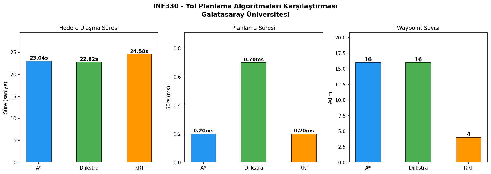

# Path Planning in Webots

A Webots e-puck simulation comparing **A\***, **Dijkstra** and **RRT** in environments with static and moving obstacles. Developed for INF330 Robotics at Galatasaray University.

## Features

- Grid-based planning with obstacle inflation and blocked-corner checks.
- Three obstacle densities and three moving-obstacle speeds.
- Proximity-based avoidance and bounded replanning when the robot gets stuck.
- Goal-distance validation, JSON experiment logs and comparison plots.

## Requirements

- Python 3.10 or newer.
- Webots R2023b (the version referenced by the world files).
- Matplotlib for plots; the planning algorithms use the Python standard library.

## Run

From the repository root:

```sh
python -m pip install -r requirements.txt
python main.py
```

The terminal menu starts a scenario, selects an algorithm, or analyzes completed runs.
Menu labels and simulation messages are in Turkish. Algorithm selection is stored in the
local, Git-ignored `run_config.json`; selecting an algorithm no longer rewrites source code.

If Webots is not found automatically, set its executable path:

```powershell
$env:WEBOTS_EXECUTABLE = "C:\Program Files\Webots\msys64\mingw64\bin\webotsw.exe"
python main.py
```

On Linux/macOS, use `export WEBOTS_EXECUTABLE=/path/to/webots`.
You can also open a `.wbt` file directly in Webots.

## Layout

```text
controllers/       Robot planner and moving-obstacle controllers
worlds/            Three supplied Webots worlds
analysis/          Result summaries and plotting
experiments/       Resumable, isolated 81-run experiment runner
examples/          Previously recorded results
results/           Local runtime output (ignored by Git)
tests/             Regression and optional simulator checks
main.py            Terminal launcher
worlds_config.py   Moving-obstacle scenario generation
results_io.py      Compatible result reading and atomic saving
experiment_config.py Shared algorithm, seed and batch settings
```

Keep `controllers/` and `worlds/` as siblings so Webots can resolve controllers.
Generated scenarios contain 2, 5 or 10 moving obstacles in addition to the existing static boxes.

## Results

New runs write `results/webots_results.json`. Each record includes the algorithm, scenario,
total planning time, simulation time, traveled distance, replans, proximity events and outcome.
Proximity events are **not** measurements of physical collisions. New runs also record
above-floor contact episodes from Webots contact tracking: rising contact edges above
Z=0.01 m, including robot descendants, with ground contacts excluded.
An experiment ends after reaching the goal, 180 simulation seconds, or 20 replans.
After a failed replan the robot holds both motors stopped until a new feasible route is found
or the experiment limit is reached. Its saved trajectory includes the final measured position.

```sh
python analysis/analyze.py
```

The analyzer exports per-algorithm/per-density/per-speed statistics, success rates,
failure reasons, coverage, sample standard deviations, CSV, JSON, Markdown, comparison
figures and sampled trajectories. Successful travel/path metrics exclude failed trials;
failure counts remain in success-rate denominators. Missing measurements remain `N/A`.

The overview `results/webots_results.png` displays only measured metrics. Single observations
use bars with `n=1`, rather than collapsed box plots. Empty input produces a coverage report
and an explicit message, not a blank PNG.
Reusing an analysis directory removes old generated figures that are no longer linked by the
new report. Malformed result/trajectory data is rejected with an error instead of producing
an unreliable chart. The command exits with a nonzero status on invalid input.

To analyze the supplied legacy example without changing your measurements:

```sh
python analysis/analyze.py --input examples/results_legacy.json
```

## Reproducible experiment matrix

```sh
python experiments/run.py --dry-run
python experiments/run.py --output results/benchmark.json
python analysis/analyze.py --input results/benchmark.json
```

Defaults are 3 algorithms × 3 densities × 3 moving speeds × seeds 7/8/9 = **81 runs**.
The same seed drives obstacle direction and the Webots world RNG; RRT uses that seed
and accepts seed values from 0 through 2147483647. Only one interactive simulation should
write a project's result file at a time; the batch runner already runs sequentially.
RRT uses deterministic offsets for replans. Scheduling/physics can still introduce differences.
Each run uses a temporary project copy and quits after saving its result. Interrupted batches
resume by run ID and source hash. Simulation outcomes and infrastructure/startup errors are
recorded separately. Three infrastructure errors stop a batch for diagnosis.

For one condition:

```sh
python experiments/run.py --algorithms RRT --densities low --speeds slow --seeds 7
```

The [pilot analysis](docs/analysis_pilot/report.md) uses one actual recorded run from
`examples/pilot_run.json`. It is **not** the completed 81-run benchmark. The full matrix
is currently unmeasured; the latest local Webots attempt failed before project loading,
including `webots.exe --version` (Windows exit 3221226356).



The image summarizes three earlier low-density runs; it is not a complete benchmark.
Previous end-to-end checks reached the goal in the low-density static and slow-moving scenarios.
Results depend on scenario geometry and obstacle motion; success is not guaranteed in every world.

## Tests

```sh
python -B tests/check.py
python -B tests/analysis_smoke.py
python -B tests/webots_smoke.py
python -B tests/webots_smoke.py --speed slow
python -B tests/webots_smoke.py --algorithm Dijkstra
python -B tests/webots_smoke.py --algorithm "A*"
```

Regression checks do not require Webots or Matplotlib. Simulator checks require Webots and
use a temporary project copy. They verify completion and report the experiment outcome;
a completed unsuccessful experiment is reported as such.

## Credits

Webots and the referenced e-puck/object PROTO models are provided by Cyberbotics.
World files reference the upstream models instead of bundling the simulator.
