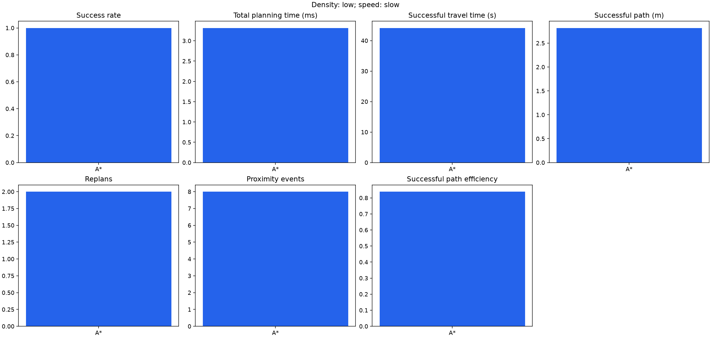
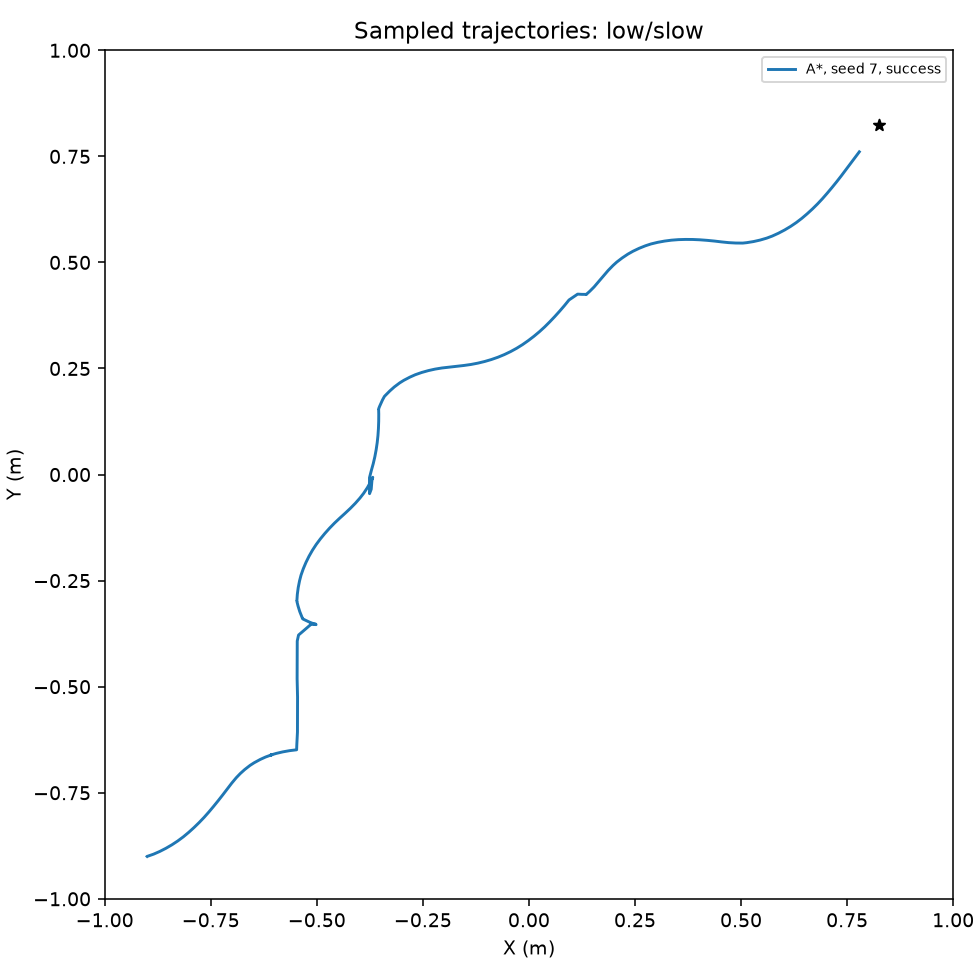

# Path planning experiment analysis

Records: 1. Complete dynamic-scenario cells: 0/27; target: 3 distinct seeds per cell.

## Interpretation

- Travel time, actual path length and efficiency include successful runs only.
- Planning time, replans and proximity events include both successes and failures.
- Failure counts remain in success-rate denominators. Failed-run durations are separately exported in JSON.
- Missing values remain N/A; one observation does not define sample standard deviation.
- Seed coverage is a reproducibility check, not proof of statistical independence.
- Obstacle events are proximity-state entries, not measured physical collisions.
- Collisions are rising edges of Webots contact above floor Z+0.01 m; persistent contact counts once. Ground contacts are excluded.
- Descriptive means do not establish statistical significance or a universally best algorithm.

## Warnings

- Experiment matrix incomplete: 0/27 cells have 3 distinct seeds.
- Single-run groups have no sample standard deviation; no statistical significance is claimed.

## Scenario summaries

| Algorithm | Density | Speed | Runs | Success | Planning ms | Successful travel s | Successful path m | Replans |
| --- | --- | --- | ---: | ---: | ---: | ---: | ---: | ---: |
| A* | low | slow | 1 | 100.0% | 3.317 | 44.160 | 2.818 | 2.000 |

## Failures

No failed simulation records.

## Artifacts

- [Coverage CSV](coverage.csv)
- [Full statistics JSON](summary.json)
- [Summary CSV](summary.csv)
- No failure CSV: no failed simulation records in this input.

## Unrecorded measurements

collisions
These fields are omitted from the CSV, not filled with zeros.

